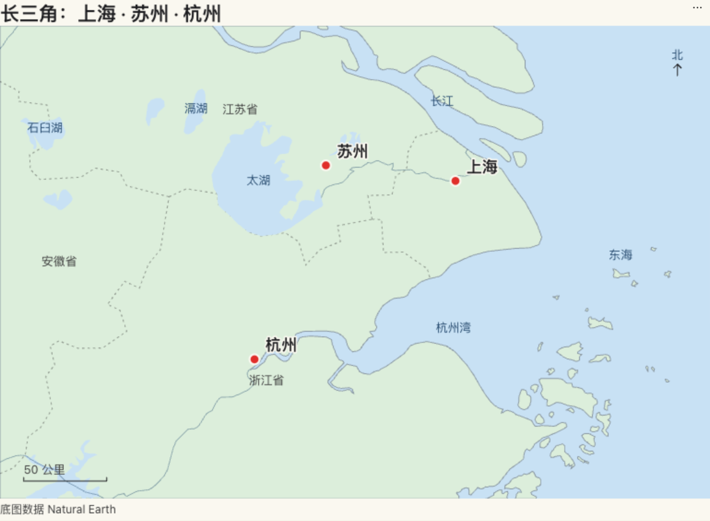

# 对话可视化与历史 GenUI

## FlowChat 的交互式可视化

新回复可以保存为 `openbitfun://current-session/artifacts/visualizations/v2/<slug>.html`。FlowChat 按原始内容引用中的 URI 找到同一轮、同一子 Agent 的成功 Write，使用调用中保存的字节创建隔离的 iframe。同轮 Edit 在回复发出前生效。执行端在成功的 Write 和 Edit 结果中记录会话 URI；通过该会话本地存储目录的绝对路径修改图时，也会带上同一 URI。新的 Edit 还保存该次修改的完整源码。执行端完成对话轮次时，将最后一次通过检查的 Write 或 Edit 中的原始源码和 UTF-8 字节数保存在该轮记录中。旧版写入记录沿用完成时的文件快照。通过脚本生成的图也能发布，前提是该轮使用了可视化技能，且被引用的文件在该轮内生成或修改。FlowChat 收到已完成的回复和重开历史消息时都使用这份源码。读取旧回复时，执行端从已记录的 Write 或完整 Edit 开始，按顺序精确回放截至该条回复的修改。后续对话可以只修改已有图，新的回复使用当轮 Edit 返回的完整源码，上一条回复保持修改前的样子。生成成功后，图直接出现在回复里。若模型在最终文本里漏写内容引用，FlowChat 会在已完成的该轮回复中补上有成功记录的图，已引用的图只显示一次。原版图表的 `mountChart`、四个专用组件、地图、插图、变体轮播和设计控件都能使用同一入口。参考图仅用于测试。模型按用户的题目自行编排内容。 FlowChat 将当前聊天区域的颜色和字体通过展示通道传给已打开的图。切换主题或皮肤时，图内使用原版 CSS 变量的标记和控件会随之更新，交互状态留在原来的文档中。

常规构建随源码提供 OpenBitFun 的技能入口、隔离渲染外壳、Apache ECharts 和离线地图。Vite 打包地图投影 worker 及其数据，Rust 嵌入技能。构建入口会通过 SHA-256 检查随仓库分发的依赖和地理数据，开发者也可以运行 `pnpm run visualize:verify` 单独检查。Write 和 Edit 在桌面后台实际渲染并返回本次产物的引用；无图形宿主时检查延至阅读端，使用产生图表的那条用户请求。若街道图只保存了声明，读者可以选择联网加载底图；成功后，同一修订可在本机离线回放。Codex Visualize 1.0.109 的本地兼容套件是可选项。原包标注为专有许可，Git 仓库记录文件校验值。Rust 的 debug 和 release 构建均排除本机原包和扩展指南。只有桌面开发服务器在本地确认套件可用时才向模型提供扩展指南。按时间规划出行时可使用日历；询问位置、地图或空间关系时可使用地理底图。已有原包的开发者可以运行 `pnpm run visualize:import-reference` 导入扩展指南及兼容资源。

普通城市标注图可以在技能交付的 HTML 中声明地点及可选范围。FlowChat 使用随产品分发的 Natural Earth 底图与地名，将声明投影成 SVG，检查城市标注和底图并保存该次检查的 SVG。断网重开历史图时，地理图层已经包含在回复中。皮肤控制画布和字体，水域、陆地、标记各自使用独立的语义颜色。

宿主绑定 `window.openai.setWidgetState`、`visualization.onData` 和 Tweak。阅读状态按设备来源、会话、对话轮次、模型轮次、写入及 URI 保存，单份上限 16 KiB。追问可携带 `modelContent`。`privateContent` 留在阅读端。部分已有图把选择保存在 `privateContent`，却从 `widgetState` 顶层读取。阅读端提供不可枚举的同名读取属性，保留已有顶层字段，持久化和追问仍使用原有格式。原版导出脚本支持按需生成独立 HTML。

数据声明使用片段开头的 `vis-bindings`。JSON 直接返回，图片声明提供 HTTPS 地址，相对文件和 `libfile_…` 数据从同一轮已完成的写入中取值，工具输入必须与同轮成功的调用一致。打开「数据来源」可以查看声明、订阅此会话以后完成的匹配结果，或将刷新请求放入输入框，由正常的 Agent 工具权限流程执行。读者还可选取已连接的 MCP 服务所公布的只读资源，按声明的间隔更新 JSON 或文件。关闭来源面板时连接继续，离开图表时结束。连接失败或未能取得数据时，来源面板显示当前状态。使用远程工作区时，图表回放读取原会话记录，连接宿主 MCP 资源会提示不可用。

首次验图、首次显示和恢复读者选择使用同一双层沙箱。外层限制子页面导航，内层使用本地脚本、数据和图片字节。浏览器宿主按声明中的固定 HTTPS 地址匿名读取 CORS 图片，拒绝重定向，仅接受 256 KiB 以内的栅格图片。没有私有数据绑定的图表可以引用受支持 CDN 的经典脚本。宿主按声明的地址匿名读取脚本，将其字节随验过的 HTML 封存，重开时直接使用。包含依赖的图表仍受 1 MiB 上限约束。已知图表模块优先使用内置版本，缺失时按发行清单的固定地址和摘要加载。MCP 浏览要求能确认工作区归属；未知或远程工作区显示资源不可用。

桌面后台按产生工具调用的会话、回合和调用 ID 解析绑定。封存记录携带验图时的绑定快照。生产回合尚未加载或声明的绑定还未到齐时，后台延后验图。阅读端可从原回合补齐旧快照中缺失的值，同时保留已经验过的值。长会话回放从封存记录补齐主回复中缺少的图。空白或超限的最新修订使该图退出发布。

通过手机或聊天机器人发起请求时，宿主按文件交付：在原工作区生成独立 SVG 或 HTML，最终回复附上 `computer://` 下载链接。桌面 FlowChat 与 Peer 桌面仍可使用内联图表。

浏览器验收运行 `node scripts/test-visualize-host.mjs`。默认使用本地 Vite 测试页，`OPENBITFUN_VISUALIZE_OFFLINE=1` 拦截外部网络，`OPENBITFUN_REFERENCE_FRAGMENT` 可指定用于对照的原图。使用 `OPENBITFUN_VISUALIZE_TEST_SKIN` 可替换默认测试皮肤。

## 早期 visualize 会话产物

启用内置 `visualize` 技能的会话可以通过普通 Write 生成 HTML。模型在回复里用单独一段 Markdown 链接引用 `openbitfun://current-session/artifacts/visualizations/<slug>.html`，链接文字提供纯文本摘要。组件输入及示例见[技能契约](../../src/crates/assembly/core/builtin_skills/visualize/references/components.md)。

FlowChat 按会话、轮次和子 Agent 身份查找该段文字之前最后一次成功的对应 Write。历史呈现使用工具调用中已记录的 HTML，并对照 Write 结果的 UTF-8 长度；同名文件的后续修改不会改变此前回复。已有 Write 记录可用 bytes_written 校验，新结果另外包含 content_bytes，支持重复写入相同内容时的校验。记录缺失、传输截断或格式未知时保留文字摘要并说明交互不可用。读取记录不需要沿链接打开文件或访问控制端的工作区。无图形渲染的入口可以呈现原有 Markdown。

版本 1 使用惰性 HTML 模板解析声明式 figure，用产品自带的图表运行时呈现已校验的数据，普通 HTML 使用禁用脚本的隔离文档。筛选和所选行属于当前阅读设备的视图偏好，按来源设备、会话、回复和写入记录保存。追问由阅读者加入输入框，阅读者可以修改和发送。旧的 GenerativeUI 工具已退出注册表、智能体默认工具、能力搜索及组件库设置。历史记录保留原有 schema 和组件库版本，直接调用和 CallDeferredTool 的旧消息均按只读方式回放。当前运行时使用通用工具参数事件；旧主机发送或日志中保存的 GenUIStream 仍可解码。打开历史消息不会向模型提交修复请求。

## 组件验收

当前兼容测试覆盖 Visualize 1.0.109 的 charts 1.8.1、历史图使用的 charts 1.6.5，以及 widgets 1.0.59。OpenBitFun 使用独立的声明式输入和本地渲染器。可信代码随产品提供。macOS WKWebView 也验证了图表筛选、参数滑块、请求自身耗时、非连续 CPU 调用与刷新恢复。以下用例通过实际组件数据验算以及 Chromium 中的 FlowChat 回复回放检查。可运行的验收位于 [图表断言](../../src/web-ui/src/tools/visualize/components.test.ts) 和 [浏览器用例](../../scripts/test-visualize-browser.mjs)。

| 组件 | 核对内容 |
| --- | --- |
| 折线 | 数值横轴排序、零值和缺口、参考线、点标注与置信带 |
| 面积 | 绝对堆叠与零观测 |
| 柱状 | 横向布局，隐藏系列后百分比重新归一化 |
| 饼图 | 环形比例、中心值与份额 |
| 直方图 | 原始观测重复计数、最大值归箱、非等宽密度面积 |
| 收支瀑布 | 起止余额核对、负值跨零 |
| 热力图 | 类别次序、颜色值域与空单元格 |
| 散点 | 分组拟合、二次拟合、退化输入 |
| 漏斗 | 保留给定阶段顺序，区分零值和缺失 |
| 箱线 | 原始观测插值四分位、离群点、给定五数概括 |
| 迷你趋势图 | 隐藏轴和点、键盘读数 |
| 排名 | 三种排序与展开剩余行 |
| 桑基 | 多阶段同名节点与共享流量汇总 |
| 日历 | 日周月切换、事件详情和恢复 |
| 请求瀑布 | 嵌套重叠耗时、父行折叠、关键路径、缩放与恢复 |
| CPU 火焰图 | 空闲区间、非连续调用、递归、函数汇总与恢复 |
| 错误堆栈 | 异步边界、运行时分组、源代码行和原始异常链 |
| 基础交互 | 卡片、表格、按钮、表单、键盘标签页、进度条、参数滑块与追问草稿 |

`layers` 是 OpenBitFun 给分层架构概览提供的组件。它按给定顺序显示各层，支持鼠标和方向键切换职责、路径和代表模块。窄屏把详情移到图下方，重新打开同一条回复可恢复阅读位置。

图解型标签页复用 `tabs`。每页可组合流程节点、可切换的方案和有序层级；节点使用内置线稿，也可提供自定义 SVG 路径。产品对照用例保留了 Codex 示例的三个视角、四种工作模式与四种远程场景。图随消息排版，阅读位置由当前设备保存。

## 旧版 OpenUI 只读回放

旧会话中的 `GenerativeUI` 与 `CallDeferredTool` 记录仍使用原来的工具标识、源码、组件库版本和已保存的状态。FlowChat 遇到这类消息才加载 OpenUI 阅读器；未知版本保留原始内容。历史 HTML、SVG 和嵌入的 HtmlView 使用禁用脚本的静态文档。已保存的 YouTube 视频以链接回放，打开消息时不启动第三方播放器。旧展厅、宿主图搜、地名查询、路线查询和 MCP 提供器均已退役。旧控制端向新版 Peer 请求该提供器时收到明确的退役原因。
